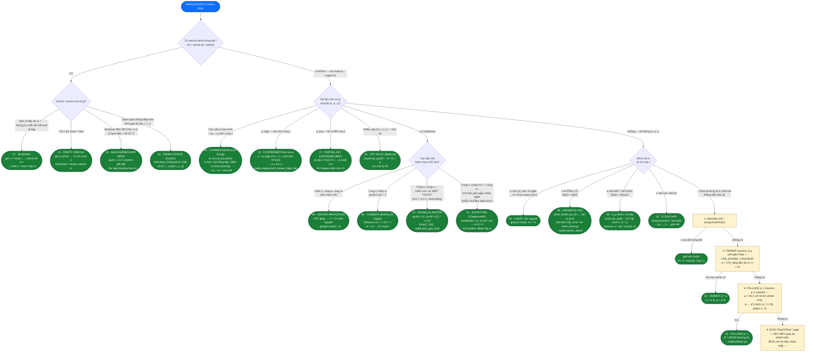

# RSA — Sơ đồ nhận diện dạng bài

> **Cách dùng:** nhận source chall RSA → đọc sơ đồ **từ node đầu xuống dưới**, trả lời lần lượt các câu hỏi (hình diamond). Lá xanh lục = kết luận dạng bài + công thức giải. Bộ 18 dạng chuẩn nằm tại `rsa/challenge/` (lời giải mẫu `rsa/solves/`, thư viện `rsa/challenge/_lib/rsalib.py`, lý thuyết: `rsa/RSA-survey-vi.md`).

## Sơ đồ quyết định (tuần tự từ trên xuống)

## Tra ngược: tín hiệu trong source/output → dạng

Nhận source thì grep/dò các mẫu này trước — ra ngay dạng bài:

| Thấy gì trong chall | Dạng | Bài |
|---|---|---|
| `getPrime(48)`, n < 300 bit | N quá nhỏ → factor trực tiếp | 01 |
| `next_prime(p)`, `gen_prime_near`, q sinh từ cùng base | Fermat p ≈ q | 02 |
| `e = 3`, không pad, flag ngắn, `assert m**3 < n` | Căn bậc e nguyên | 03 |
| Nhiều dòng `n1..ne` + `c1..ce`, cùng e | Håstad broadcast | 04 |
| Cùng n, hai `e_b`, `e_c` coprime | Common modulus ngoài | 05 |
| **Cho sẵn `d`** (+ e₂, c₂ cùng n) | Common modulus trong → suy phi | 06 |
| Server hỏi `Text to decrypt:` | Blinding oracle | 07 |
| `e.bit_length()` ≈ `n.bit_length()` (e ~ 1024 bit) | Wiener d nhỏ | 08 |
| `e = pow(dp, -1, p-1)` — e ~ 512 bit khi n 1024 bit | Brute d_p nhỏ | 09 |
| Log nhiều cặp `m_i`, `s_i` chữ ký | CRT fault — gcd(ŝᵉ−m, n) | 10 |
| Server trả `Even` / `Odd` | Parity oracle | 11 |
| `p = m + 1` với m = tích các prime nhỏ | Pollard p−1 | 12 |
| 2 ct, `M2 == M1 + 1` (serial/counter tăng) | Franklin–Reiter | 13 |
| `block[0:2] == b"\x00\x02"`, PKCS#1 conform oracle | Bleichenbacher | 14 |
| `p_high = p >> U` cho kèm trong output | Coppersmith bit cao | 15 |
| `M = (msg << 32) \| r` gửi 2 lần với r khác nhau | Short-pad attack | 16 |
| `d_low = d % 2^s` cho kèm | Partial key exposure BDF | 17 |
| Hàng nghìn dòng `M_i T_i` (thời gian µs) | Timing attack Kocher | 18 |

## 18 dạng — điều kiện toán & lệnh giải

| # | Dạng | Điều kiện | Giải (1 dòng) | Tool |
|---|---|---|---|---|
| 01 | N quá nhỏ | n < ~300 bit | `sympy.factorint(n)` → d | factordb / factorint |
| 02 | Fermat | \|p−q\| nhỏ, n gần a² | a=⌈√n⌉ dần lên, b²=a²−n | ~20 dòng python |
| 03 | e nhỏ | mᵉ < n (chưa wrap) | `gmpy2.iroot(c, e)` | gmpy2 |
| 04 | Håstad | cùng m, e bản mã, khác n_i | CRT → iroot(C, e) | CRT tay / gmpy2 |
| 05 | CM ngoài | cùng n, gcd(e1,e2)=1 | Bézout: m = c1ᵘ·c2ᵛ | xgcd (lưu ý u âm → inverse) |
| 06 | CM trong | biết (n,e,d) | k=(ed−1)//n++ → phi (Δ chính phương) | python thuần |
| 07 | Blinding | oracle giải mã trừ flag | c·rᵉ → m·r → ·r⁻¹ | 1 query |
| 08 | Wiener | d < ⅓·N^¼ (e cực lớn) | liên tục e/n → (k,d) → phi | `rsalib.wiener_attack` |
| 09 | d_p nhỏ | d_p ~ 2²⁰ (e ~ n/2 bit) | brute dp, gcd(r−r^{e·dp}, n) | pow nhanh (rᵉ)^dp |
| 10 | CRT fault | 1 chữ ký sai mod q | gcd(ŝᵉ − m, n) = p | duyệt log |
| 11 | Parity | oracle chẵn/lẻ | ct·(2^k)ᵉ, halve khoảng | ~log₂n query |
| 12 | Pollard p−1 | p−1 B-smooth | a←a^j, gcd(a−1,n) | `rsalib.pollard_p1` |
| 13 | Franklin–Reiter | m2 = m1 + h (h biết) | gcd đa thức mod n | `rsalib.poly_gcd_mod` |
| 14 | Bleichenbacher | oracle conform 00 02 | BB'98: quét s, intersect khoảng | ~1.4M query offline |
| 15 | Coppersmith cao | biết ≥ n/4 bit cao của p | p_high·2^u + x → LLL | `coppersmith_known_high_bits` |
| 16 | Short-pad | cùng m ± pad ngắn, e=3 | resultant → Δ → FR | `coppersmith_small_roots` + FR |
| 17 | BDF bit thấp d | biết ≥ ⌈n/4⌉ bit thấp d | quad mod 2^s → p_low → 15 | `solve_quad_mod_2k` + Cop |
| 18 | Timing | T_i phụ thuộc phép nhân | corr(T, cost(C·z)) từng bit d | numpy corr, 8192 mẫu |

## Khi (n, e, c) "sạch sẽ" — thang phân tích N

Theo thang bậc trong `tools.md` (factordb trước, Fermat ngay sau):

1. **factordb** (qua `factordb-python`) — n nằm sẵn trong DB thì xong ngay.
2. **Fermat** — p, q gần nhau (việc này rẻ, cứ chạy 1–2 phút trước khi nghĩ tiếp).
3. **Pollard p−1** — p−1 smooth; kèm **p+1 (Williams)** nếu đề sinh prime đặc biệt.
4. **ECM** (PARI `factorint` flag 2 / sage `ecm`) — thừa số nhỏ hơn ~60 digit.
5. **RsaCtfTool** (Win-WSL) — quay đại các attack phổ thông.
6. Vẫn chết → **quay lại đọc source lần 2**: đề 18/18 dạng nào cũng có tín hiệu ở nhánh trên của sơ đồ.

## Phân biệt các cặp dễ nhầm

- **03 vs 04**: cùng e=3 — chỉ 1 bản mã thì m³ phải *nhỏ hơn* n mới iroot được; có đủ e bản mã *khác n* thì CRT trước rồi iroot.
- **08 vs 09**: e đều "dài bất thường" — **bit(e) ≈ bit(n)** → d nhỏ (Wiener); **bit(e) ≈ bit(n)/2** → d_p nhỏ (e sinh theo p−1). Wiener fail nhưng e vẫn ~ n bit → d tới N^0.292: **Boneh–Durfee** (solve mẫu trong `lattice/L11_boneh_durfee/`).
- **05 vs 06**: cùng modulus — không có d → Bézout hai bản mã; **có d của mình** →factor N / suy phi, mạnh hơn nhiều.
- **13 vs 16**: 2 bản mã cùng n cùng e — biết *chính xác* quan hệ m2−m1 → Franklin–Reiter; cùng m nhưng *chỉ khác pad ngẫu nhiên* (không biết hiệu) → short-pad (resultant trước, FR sau).
- **15 vs 17**: đều kết thúc bằng Coppersmith — leak ở **p** (bit cao, shift trái `2^u`) vs leak ở **d** (bit thấp, giải pt bậc 2 mod `2^s` chuyển leak sang p trước).
- **06 và mọi nhánh "có thêm dữ liệu"**: luôn ưu tiên nhánh có dữ liệu lạ (d, p_high, d_low, chữ ký, nhiều ct) TRƯỚC khi đánh giá (n,e,c) — đó là lý do Q2 đứng trên Q5 trong sơ đồ.
