# Symmetric Cipher — Sơ đồ nhận diện dạng bài

> **Cách dùng:** nhận source chall symmetric (AES/DES/stream/oracle) → đọc sơ đồ **từ node đầu xuống dưới**, trả lời lần lượt các câu hỏi (hình diamond). Lá xanh lục = kết luận dạng bài + công thức giải. Nguồn: 29 bài Symmetric Ciphers của CryptoHack (cryptohack.org/challenges/aes), số thứ tự 01–29 theo danh mục. Cheatsheet kỹ thuật kèm code: `cheatsheet-symmetric.md`. Solve mẫu: `Cryptohack/`.

## Sơ đồ quyết định (tuần tự từ trên xuống)

```mermaid
flowchart TD
    START(["NHẬN SOURCE CHALL SYMMETRIC"]):::start --> Q0{"Chall thuộc loại nào?"}

    Q0 -->|"Bài học implement AES<br>(code template, không service,<br>không dữ liệu ẩn)"| GA(["NHÓM HOW AES WORKS 01–07<br>state 4x4 ↔ bytes (03) · AddRoundKey = XOR (04)<br>inv S-box (05) · inv ShiftRows + inv MixColumns (06)<br>full decrypt 10 vòng: XOR k10 rồi lặp 9→1<br>invShift → invSub → XOR → invMix (07)"]):::res
    Q0 -->|"Cipher TỰ CHẾ dựa trên AES<br>(NSA-proof tweaks, S-box thay)"| QA{"Kiểm tra S-box:<br>sbox[a] ^ sbox[b] ^ sbox[0]<br>= sbox[a ^ b] với mọi a,b?"}
    QA -->|"ĐÚNG — S-box affine<br>→ cả cipher là affine trên GF(2)^128<br>E(x) = M·x + c, M KHÔNG phụ thuộc key"| R29(["29 · BEATBOXER (150)<br>tính M local bằng 128 vector cơ sở<br>1 query encrypt block 0 → c_server<br>flag = M⁻¹·(ct ⊕ c_server)"]):::res
    Q0 -->|"Có service / oracle<br>(HTTP API hoặc socket)"| Q1
    Q0 -->|"Chỉ file / output.txt tĩnh"| Q2

    Q1{"Oracle cho phép làm gì?"} -->|"Encrypt plaintext ta chọn,<br>flag nằm cùng luồng dữ liệu"| Q3
    Q1 -->|"Decrypt ciphertext ta chọn<br>(trả plaintext hoặc error)"| Q4
    Q1 -->|"Chỉ trả 1 bit valid/invalid<br>(padding, token, cookie)"| Q5
    Q1 -->|"Verify tag / xác thực<br>(AEAD, GCM)"| R28(["28 · FORBIDDEN FRUIT (150)<br>GCM + nonce dùng lại: 2 lần encrypt pt ta chọn<br>H² = (t1−t2)/(c1−c2) trong GF(2)^128<br>→ forge tag cho ct mới"]):::res
    Q1 -->|"Error message khác nhau<br>lộ thông tin keystream"| R21(["21 · OH SNAP (120)<br>RC4, key = nonce(ta chọn) + FLAG<br>error leak keystream[0] → FMS attack<br>majority vote 256 nonce"]):::res

    Q3{"Chosen-plaintext encrypt —<br>điểm bất thường ở đâu?"} -->|"flag nối SAU input ta gửi,<br>mode ECB → block lặp nhìn thấy"| R11(["11 · ECB ORACLE (60)<br>byte-at-a-time: dict mọi alignment,<br>đối chiếu block cuối cùng"]):::res
    Q3 -->|"Plaintext bị NÉN (zlib)<br>trước khi encrypt<br>→ độ dài ciphertext là oracle"| R17(["17 · CTRIME (70)<br>CRIME: gửi (guess + c)·2,<br>độ dài ngắn hơn = ký tự đúng"]):::res
    Q3 -->|"IV / nonce cố định hoặc = key<br>→ keystream DÙNG LẠI"| Q3A{"Kiểu dùng lại keystream nào?"}
    Q3A -->|"OFB và IV = key<br>→ encrypt chính là decrypt"| R15(["15 · SYMMETRY (50)<br>gửi ct gốc + IV vào endpoint encrypt:<br>E(IV) ⊕ ct = flag"]):::res
    Q3A -->|"flag + câu ta biết/gần biết<br>mã hóa cùng keystream"| R19(["19 · STREAM OF CONSCIOUSNESS (80)<br>server nói 1 câu từ lyric list + flag<br>cùng keystream → xác định câu (MTP)<br>→ keystream → flag"]):::res
    Q3A -->|"keystream chu kỳ ngắn<br>+ file ảnh có header chuẩn"| R16(["16 · BEAN COUNTER (60)<br>PNG header 89504e470d0a1a0a ⊕ ct[0:16]<br>= keystream → cycle XOR toàn file → ảnh"]):::res
    Q3 -->|"Ta được CHỌN key<br>(DES / 3DES)"| R14(["14 · TRIPLE DES (60)<br>weak keys 0101…/FEFE…: mỗi E là involution<br>EDE(K1,K2,K1) áp 2 lần = identity<br>→ encrypt(ct) trả lại plaintext"]):::res
    Q3 -->|"Key = hash(password)<br>từ từ điển"| R09(["09 · PASSWORDS AS KEYS (50)<br>brute wordlist: key = md5(word)<br>decrypt, check prefix crypto{"]):::res

    Q4{"Decrypt oracle —<br>mode và bug là gì?"} -->|"Encrypt bằng CBC nhưng decrypt<br>endpoint chỉ làm ECB (thiếu XOR)"| R10(["10 · ECB CBC WTF (55)<br>P_i = D_ECB(C_i) ⊕ C_(i−1)<br>tự XOR phía client"]):::res
    Q4 -->|"CBC, source có IV = KEY"| R13(["13 · LAZY CBC (60)<br>gửi ct = C0 + 0^16 + C0<br>key = P0 ⊕ P2<br>(P0 = D(C0)⊕key, P2 = D(C0)⊕0)"]):::res
    Q4 -->|"CFB8 (feedback theo byte)<br>+ reset password từ token ta gửi"| R18(["18 · LOGON ZERO (80) — Zerologon CVE-2020-1472<br>token toàn byte 00: pt = E(0)[0] lặp lại<br>xác suất 1/256 mỗi key: E(0)[0]=0<br>→ password_length=0 → login chuỗi rỗng"]):::res
    Q4 -->|"IGE mode + lỗi padding<br>(Telegram-style)"| R27(["27 · PAPER PLANE (120)<br>padding oracle biến thể IGE:<br>M_i = D(C_i) ⊕ C_(i−1) ⊕ M_(i−1)<br>khối sau dùng plaintext khối trước"]):::res

    Q5{"1-bit oracle —<br>độ tin cậy ra sao?"} -->|"Oracle chuẩn (luôn đúng)"| R22(["22 · PAD THAI (80)<br>padding oracle CBC kinh điển<br>plaintext hex → chỉ 16 ứng viên/byte<br>đi từ byte cuối mỗi block"]):::res
    Q5 -->|"good OR noise<br>→ False luôn đúng, True nghi ngờ"| R24(["24 · THE GOOD, THE PAD, THE UGLY (100)<br>padding oracle + query giới hạn 12000<br>mỗi True xác nhận lại ~23 lần<br>(0.6 mũ 23 ≈ sai số chấp nhận được)"]):::res
    Q5 -->|"good XOR noise<br>→ KHÔNG tin được câu trả lời nào"| R25(["25 · ORACULAR SPECTACULAR (150)<br>True sai suất 60%: LLR score từng ứng viên,<br>chỉ dồn query cho top-2 (không loại vĩnh viễn)<br>thất bại thì reconnect và làm lại"]):::res
    Q5 -->|"Cookie CBC admin=False→True<br>(KHÔNG cần oracle — tự sửa)"| R12(["12 · FLIPPING COOKIE (60)<br>sửa IV: IV' = IV ⊕ old ⊕ new<br>tại đúng vị trí False → True<br>(block i thì sửa block i−1)"]):::res
    Q5 -->|"Như Flipping Cookie nhưng<br>oracle CÓ errors (admin persuasion)"| R23(["23/26 · RHETORICAL ORACLE 1 + 2<br>(100/150) — mới ra 10/2026,<br>chưa có writeup public<br>Twist Flipping Cookie + error handling<br>→ tự giải và ghi bổ sung vào đây"]):::res

    Q2{"File tĩnh — trong đó có gì?"} -->|"Source cipher tự implement<br>gửi kèm + output.txt"| QC{"Điểm sai trong implement?"}
    QC -->|"ChaCha20 thiếu feed-forward<br>(không cộng state ban đầu)"| R20(["20 · DANCING QUEEN (120)<br>block function khả nghịch:<br>từ keystream đảo ngược 20 round<br>→ đọc key ở state[4:12]"]):::res
    Q2 -->|"Ảnh (PNG/PPM) mã hóa<br>stream cipher"| R16
    Q2 -->|"ct + key cho sẵn,<br>không gì lạ"| R08(["08 · MODES OF OPERATION STARTER (15)<br>decrypt thường qua API<br>(không tấn công — làm quen mode)"]):::res

    classDef res fill:#1a7f37,stroke:#0f5132,color:#fff
    classDef start fill:#0d6efd,stroke:#084298,color:#fff
```

## Tra ngược: tín hiệu trong source → dạng bài

| Thấy gì trong chall | Dạng | Bài # |
|---|---|---|
| Code template AES rời rạc, hỏi thuật ngữ / điền hàm | Bài học implement | 01–07 |
| `AES.MODE_ECB`, flag nối sau input ta gửi | ECB byte-at-a-time | 11 |
| `zlib.compress(plaintext)` trước encrypt | Compression length oracle (CRIME) | 17 |
| `iv = KEY` trong source | Lazy CBC (CBC) hoặc Symmetry (OFB) | 13 / 15 |
| `/decrypt` decrypt từng block độc lập (ECB) trong khi encrypt CBC | ECB CBC WTF | 10 |
| Cookie/token `admin=False` mã hóa CBC | Bit-flipping IV | 12 |
| `good \| (rng.random() > 0.4)` — oracle nhiễu OR | Padding oracle confirm ×23 | 24 |
| `good ^ (rng.random() > 0.4)` — oracle nhiễu XOR | LLR adaptive top-2 | 25 |
| `unpad()` try/except trả True/False qua socket | Padding oracle kinh điển | 22 |
| `DES3` + ta được chọn key | Weak keys, 3DES² = identity | 14 |
| `key = MD5(password)`, gợi ý từ điển | Wordlist brute | 09 |
| CFB8 feedback từng byte + reset password theo token | Zerologon (token 00) | 18 |
| Ảnh PNG/PPM trong files + stream cipher | Known-header keystream | 16 |
| Cùng keystream cho 2 bản mã (nonce cố định) | MTP / xác định plaintext | 19 |
| RC4 + key = nonce ∥ secret + error msg | FMS attack | 21 |
| ChaCha20 tự viết, thiếu `+= initial state` | Đảo ngược block function | 20 |
| IGE mode (m0, c0 hai khối khởi tạo) | Padding oracle IGE | 27 |
| `AES.MODE_GCM`, nonce lặp lại giữa 2 encryption | Forbidden attack — H² → forge | 28 |
| S-box lạ → test `sbox[a]^sbox[b]^sbox[0]==sbox[a^b]` | Cipher affine GF(2)^128 | 29 |

## 29 bài — điều kiện & công thức

| # | Bài (điểm) | Nhận diện | Tấn công | Giải 1 dòng |
|---|---|---|---|---|
| 01 | Keyed Permutations (5) | câu hỏi lý thuyết | — | bijection |
| 02 | Resisting Bruteforce (10) | câu hỏi lý thuyết | — | biclique |
| 03 | Structure of AES (15) | code bytes2matrix | — | flatten ma trận |
| 04 | Round Keys (20) | state + round key | — | XOR từng byte |
| 05 | Confusion through Substitution (25) | state + inv S-box | — | áp inv S-box từng byte |
| 06 | Diffusion through Permutation (30) | diffusion.py | — | inv MixColumns + inv ShiftRows |
| 07 | Bringing It All Together (50) | key + ct, 10 vòng | — | full AES-128 decrypt |
| 08 | Modes of Operation Starter (15) | API encrypt/decrypt | — | gọi encrypt_flag rồi decrypt |
| 09 | Passwords as Keys (50) | key = md5(word) | dictionary | brute wordlist, check crypto{ |
| 10 | ECB CBC WTF (55) | encrypt CBC, decrypt ECB | thiếu XOR | P_i = D_ECB(C_i) ⊕ C_{i−1} |
| 11 | ECB Oracle (60) | ECB, flag nối sau input | byte-at-a-time | dict alignment, khớp block |
| 12 | Flipping Cookie (60) | cookie CBC admin=False | bit-flipping | IV' = IV ⊕ old ⊕ new |
| 13 | Lazy CBC (60) | CBC IV = key | key recovery | key = P0 ⊕ P2 với ct C0∥0∥C0 |
| 14 | Triple DES (60) | 3DES chọn key | weak keys | encrypt(ct) với K weak = pt |
| 15 | Symmetry (50) | OFB IV = key | enc = dec | gửi ct vào endpoint encrypt |
| 16 | Bean Counter (60) | PNG + CTR tự chế | known header | header ⊕ ct[:16] → keystream |
| 17 | CTRIME (70) | zlib + CTR | length oracle | đoán từng char, ct ngắn = đúng |
| 18 | Logon Zero (80) | CFB8 + reset password | Zerologon | token 00×29, retry 1/256, login rỗng |
| 19 | Stream of Consciousness (80) | keystream dùng lại | MTP | tìm câu lyric → keystream → flag |
| 20 | Dancing Queen (120) | ChaCha20 thiếu feed-forward | invert | đảo block, key = state[4:12] |
| 21 | Oh SNAP (120) | RC4 + error leak | FMS | majority vote keystream[0] theo IV |
| 22 | Pad Thai (80) | padding oracle sạch | PO kinh điển | 16 ứng viên/byte (hex) |
| 23 | Rhetorical Oracle (100) | admin + oracle có errors | TBD 10/2026 | chưa có writeup public |
| 24 | The Good, The Pad, The Ugly (100) | noise \| (False đúng) | confirm ×23 | xác nhận từng True |
| 25 | Oracular Spectacular (150) | noise ^ (không tin gì) | LLR top-2 | score ứng viên + reconnect |
| 26 | Rhetorical Oracle 2 (150) | tiếp 23, khó hơn | TBD 10/2026 | chưa có writeup public |
| 27 | Paper Plane (120) | IGE + padding error | PO trên IGE | chain M_{i−1}, C_{i−1} |
| 28 | Forbidden Fruit (150) | GCM nonce reuse | forbidden attack | H² = (t1−t2)/(c1−c2), forge tag |
| 29 | Beatboxer (150) | S-box affine | affine cipher | flag = M⁻¹(ct ⊕ c_server) |

## Cặp dễ nhầm

- **11 vs 17**: cả hai đều "encrypt input ta chọn có flag trong luồng" — ECB nhìn **block lặp** (cấu trúc), CTRIME nhìn **độ dài ct** (nén). Có `zlib` là chuyển ngay sang length oracle.
- **22 / 24 / 25**: cùng một padding oracle, khác **độ nhiễu** — sạch (22), `good | noise`: False đáng tin → xác nhận ×23 (24), `good ^ noise`: không tin được cái nào → thống kê LLR + reconnect (25). Đọc dòng oracle trong source là biết ngay mức nào.
- **12 vs 23/26**: Flipping Cookie chỉ cần **encrypt + submit** (không có oracle trả lời); Rhetorical là twist "thuyết phục admin" khi oracle có errors.
- **13 vs 15**: cùng tín hiệu `iv = KEY` — CBC thì recover key (gửi C0∥0∥C0), OFB thì encrypt = decrypt (gửi lại ct). Nhìn mode trước khi chọn hướng.
- **16 vs 19**: cùng keystream reuse — 16 có **header file chuẩn** (PNG magic) lấy keystream trực tiếp; 19 phải **đoán/xác định plaintext** (lyric) trước.
- **20 vs 29**: "cipher tự chế" có hai hướng — bug cụ thể trong implement (20: thiếu feed-forward → khả nghịch) vs thành phần phi tuyến bị thay (29: S-box affine → toàn cipher affine). Test affine của S-box trước (1 dòng), nếu không affine thì đọc kỹ vòng implement.
- **10 vs 4-decrypt-oracle**: ECB CBC WTF không phải oracle 1-bit — endpoint decrypt **trả plaintext thật**, chỉ thiếu bước XOR mà ta tự làm.

## Ghi chú

- Rhetorical Oracle 1/2 ra mắt ~10/2026 (77/65 solves), chưa có writeup public — khi bạn giải xong, cập nhật các dòng TBD ở bảng và thêm lá vào sơ đồ.
- Nguồn scout: cryptohack.org/challenges/aes + các writeup HackMD (CayCon, K-DA, collection FLKCV), Habr (padding family), repo jeonyujin4209/crypto_ctf (Beatboxer, Oracular Spectacular), 0awawa0 Medium (Logon Zero = Zerologon).
