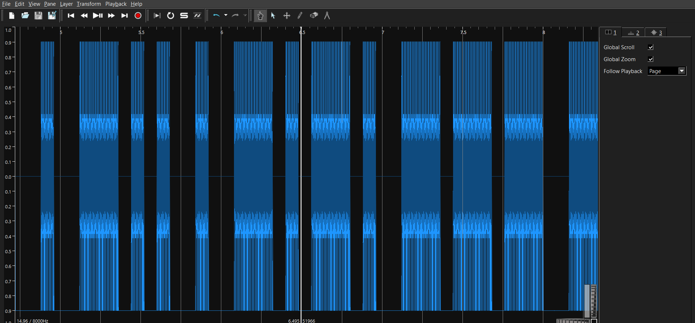

# bai-09-voip-morse

**Thể loại:** forensics / network

## Đề bài

Một phiên VoIP bị bắt gói. Phần signaling SIP trông bình thường, nhưng thông điệp thật nằm trong luồng media chứ không phải metadata của cuộc gọi. Hãy nhận diện codec, trích âm thanh và giải mã thứ thực sự đang được truyền.

## Lời giải

**1. Nhận diện codec từ SDP.** Trong các gói SIP (UDP 5060), SDP offer chứa `a=rtpmap:0 PCMU/8000` — vậy media là RTP payload type `0`, tức G.711 µ-law (PCMU) tại 8 kHz.

**2. Lắp ráp lại luồng RTP.** Parse pcap, nhận diện header RTP (version 2, header ≥ 12 byte, không phải RTCP), nhóm theo SSRC và sắp theo sequence/timestamp.

**3. Giải G.711 µ-law ra PCM.** Nối các payload PT=0 lại, decode µ-law thành PCM16 @ 8 kHz, ghi ra file WAV.

**4. Đọc tín hiệu ẩn.** Âm thanh thu được không phải tiếng nói — Sonic Visualiser cho thấy các dải tone ghép thành **mã Morse**:



```
-.-- ----- ..- .- .-. . -.. . -.-. --- -.. . -.. ...- ----- .---- .--.
 Y    0   U  A  R  E   D  E   C   O  D   E  D   V    0   1   P
```

## Flag

```
XHM{Y0UAREDECODEDV01P}
```
